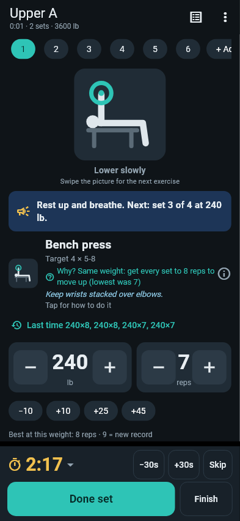
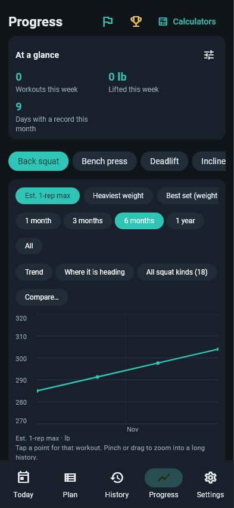
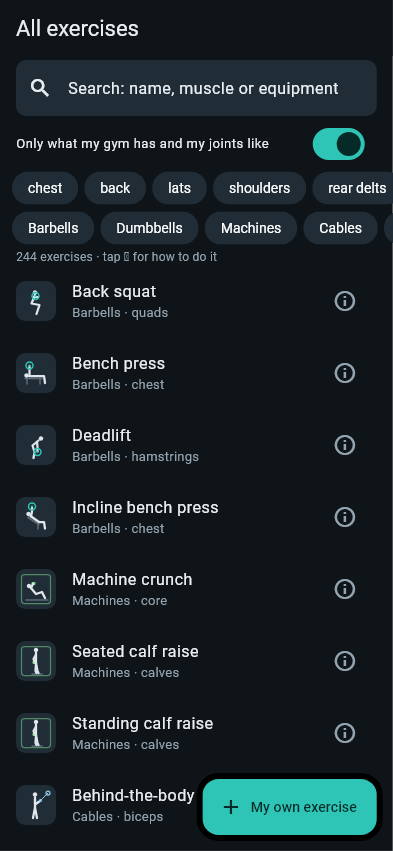
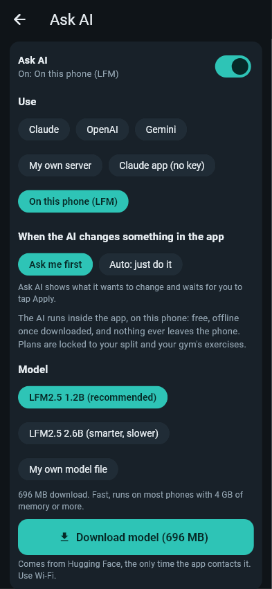

# FightMilk

A free Android app for people who lift heavy: machines, barbells, dumbbells. It designs your workouts, logs your sets in one tap, shows your progress, and collects nothing about you.

- **No account, no tracking, no ads.** Your workouts stay on your phone. The app only goes online when you choose to: to ask the AI you picked, to check for a new version or icons on GitHub, or to download the on-phone AI model once.
- **Designs the workout for you.** Pick a split (push/pull/legs, upper/lower, full body, one muscle a day) or let the app choose. A built-in plan maker works with no AI at all; it adds weight when you hit your reps and backs off when you miss twice.
- **One-tap logging.** Weight and reps are already filled in. Smart rest times based on how heavy the set was and how hard it felt. The rest timer buzzes with the screen off.
- **296 exercises** with how-to explanations and animations showing each movement, swaps for the same muscles with what your gym has, and full plan editing.
- **Your gym, exactly.** Gym profiles list the machines and equipment each gym really has (start from a Planet Fitness, big gym, home or hotel template and tick what you see). Plans, swaps and the AI only use what is there; mark a machine "taken today" and it is left out until tomorrow.
- **Real training tools.** Warm-up, drop, failure, AMRAP and rest-pause sets; supersets; plates per side from your gym's bar and plates; warm-up sets worked out for you; a hold timer, EMOM, Tabata and stopwatch; calculators for 1RM, rep maxes and RPE.
- **Progression you can tune.** Slow, steady or fast; your Easy/Hard taps change the next jump; linear or reps-first per lift; deload weeks; a quick "how do you feel?" that lightens a rough day; a "bad day" option so one off session doesn't drop your weights.
- **Your own exercises, favourites and never-use list**, body weight log, pinned notes per exercise (seat height, grip), history search, and a summary with records when you finish.
- **A coach that guides you** through the workout, cute reward sounds (or simple ones, or none), and training reminders.
- **Optional AI coach**, off by default. See [What the AI can do](#what-the-ai-can-do). Even with it off, Ask AI understands everyday requests by itself ("chest and arms with drop sets", "remind me Mon, Wed, Fri at 6 pm", "the bench is taken").
- **Your data out, any time.** A full backup file, and every set as a CSV in the layout Strong uses, which Hevy, Liftosaur and spreadsheets can import.

## What the AI can do

The app works fully without AI. Turn it on in Settings → AI coach when you want help, and pick where it runs.

**What it does for you**

- **Make your plan.** From your setup (goal, days a week, session length, equipment, sore joints, split) it builds a whole week, or improves the built-in plan. Plan → Make a new plan → Make my plan with AI.
- **Adjust today.** Tell it how today is going ("short on time", "shoulder is sore", "benches are taken", "feeling great") and it reworks just today's workout from your recent sets. Today → Ask AI to adjust today.
- **Today's guide.** A short brief before you start: what to aim for on each lift based on last time, warm-up weights, and a form cue or two.
- **Ask AI.** Free questions about form, plateaus, rest, soreness, splits, swaps. It sees your plan and recent sets, so the answers are about your training.
- **It can change the app for you.** "Set me up a shoulders, arms and chest workout with drop sets", "swap the bench, it's taken", "I'm at Planet Fitness", "deload this week", "remind me Monday and Thursday at 6 pm": it uses the same tools as the buttons (today's workout, the plan, sets and reps, gyms, reminders, settings). Choose **Ask me first** (it shows what it wants to change and waits for Apply) or **Auto** (it just does it). Every change is listed under AI changes with Undo. It can never touch its own setup (which AI, keys, server) and cannot make the app send anything anywhere. There is no server or open port: the tools live inside the app.

Every plan or day the AI makes is checked before it is used: only your gym's exercises, nothing that loads a sore joint, sane sets, reps and rest. A bad answer is shown with the reasons and nothing changes.

**Where it runs**

| Choice | Cost | Internet | What leaves the phone |
|---|---|---|---|
| **On this phone (LFM)** | free | only to download the model once | nothing |
| **My own model file** | free | none | nothing |
| **Claude app (no key)** | your Claude/ChatGPT/Gemini subscription | yes | the request, through that app, when you tap send |
| **Claude, OpenAI or Gemini** with your own API key | a cent or two per request | yes | the request, straight to that company |
| **Your own server** (llama-server, Ollama, LM Studio) | free | your network | the request, to your server only |

- **On this phone** downloads Liquid AI's LFM2.5 model (1.2B, about 700 MB, or 2.6B for phones with 8 GB of memory). It runs inside the app with no server. A grammar locks it to your split and your gym's exercises, so even a small model can't produce a broken plan.
- **My own model file** imports any `.gguf` model you have copied onto the phone, for example one you trained yourself. It gets the same prompts and checks as the built-in model, and stays on your phone.
- **With an API key**, Claude Sonnet (`claude-sonnet-5-5`) is a good, cheap choice. Use a key made just for this app and give it a spending limit in your provider's console. The key is kept in Android's encrypted storage and only sent to that provider.

The request is always the same short text: your setup answers, your plan or today's workout, your recent sets and your question. Never your name, contacts, location or anything about the phone. You can read it before it is sent.

## Screenshots

| | | | |
|:-:|:-:|:-:|:-:|
|  |  |  |  |
| **Today** | **During a workout** | **How to do it** | **Progress** |
|  |  |  |  |
| **Your plan** | **296 exercises** | **Setup** | **AI coach on your phone** |

Rendered from the app's own screens with sample workouts (`app/test_screens/screenshots_test.dart`).

## Install

Download the APK from [Releases](https://github.com/Balderding/FightMilk/releases) (`-arm64` for almost every phone, `-universal` if unsure), open it and allow the install. Needs Android 7.0 or newer. After that the app can update itself: Settings → App updates. Every update is checked against the release's `SHA256SUMS.txt`, and Android only installs it over the old one if it is signed with the same key.

## Build it yourself

- Flutter (stable), Android SDK with NDK, JDK 17.
- `cd app && flutter test && flutter build apk --release`
- The on-phone AI engine is [llama.cpp](https://github.com/ggml-org/llama.cpp) release b12138, built from source by the app's CMake (`app/android/app/src/main/cpp`). Set `LLAMA_DIR` to a checkout of that release, or leave it unset and CMake fetches it.
- Exercise library, icons, animations and sounds are generated by the scripts in `tools/`.

## Licence

Code: GPL-3.0 (see `LICENSE`). Exercise icons, explanations, animations and sounds: CC BY-SA 4.0 (see `LICENSE-ASSETS`). Made by balderding.

The AI models are not part of this repo. LFM models are made by Liquid AI under their own licence and are downloaded from Hugging Face by the app when you ask.
