# FightMilk

A free Android app for people who lift heavy: machines, barbells, dumbbells. It designs your workouts, logs your sets in one tap, shows your progress, and collects nothing about you.

- **No account, no tracking, no ads.** Your workouts stay on your phone. The app only goes online when you choose to: to ask the AI you picked, to check for a new version or icons on GitHub, or to download the on-phone AI model once.
- **Designs the workout for you.** 1 to 7 days, 20 minutes to 2 hours, eight goals (strength, size, both, fat loss, general fitness, sport, powerlifting, powerbuilding) and nine splits, or let the app choose. It puts big lifts before small ones, keeps pushing and pulling in balance and trains each big muscle twice a week. Give muscles more or less work, run a focus block for one, tie plan days to your weekdays, and legs get lighter next to a sport day. A built-in plan maker works with no AI at all.
- **A program library.** StrongLifts 5×5, Starting Strength, GZCLP, 5/3/1 (Boring But Big, First Set Last, Leader and Anchor and more), nSuns, Madcow, Texas Method, Reddit PPL, PHUL, Smolov, Juggernaut, conjugate, bodyweight ladders and our own plans. Each comes with its own rules: sets from a training max, stages when a lift stalls, ladders to harder exercises. "Which is right for me?" picks one from three answers, and exercises your gym lacks are swapped. Plan → Programs.
- **Volume and recovery.** Sets a week per muscle against a range for your goal ("Chest 8 of 10-20"), with helper muscles counted as half a set. The plan maker lands each muscle in its range within your session time, and every plan shows its week before you start it. Progress → Muscles shows the trend over weeks to a year, a balance chart and how rested each muscle is. Today warns when a muscle is still recovering and offers a more rested day, or suggests a day off. Volume can climb through each block (Settings → Progression).
- **Pain and sore joints.** Tap a set and "That hurt": swap it, stop it for today or carry on lighter, and the next two times start lighter. "Sore today?" on Today flags and swaps exercises hard on that joint, for today only. A careful mode for pregnancy and the year after a birth leaves risky moves out (Setup → More choices); talk it over with your midwife or doctor.
- **It explains itself.** Tap "Why?" on any target in a workout: why this weight ("+2.5 kg: every set hit 8"), why this exercise and why this rest. Plan → Changes lists every weight the app moved, with the reason and Undo; Settings → Progression → How the weights move has the rules in plain words. A stuck lift (no new best in 4 weeks) gets a notice on Progress with a fix: the closest variation for 4 weeks, then back. Swaps come closest first, with a reason. The Finish screen says what happens next time, Progress suggests one change for next week, and Today has a tip of the day.
- **Charts and records.** Progress charts each lift by est. 1-rep max, heaviest weight, best set, workout volume, reps, sets, weight at N reps, workout length, how hard it felt, rest or 1-rep max per body weight, over 1 month to all time on a real date axis. Add a trend line, where it is heading, all kinds of a lift together, a second lift or your body weight; tap a point for that workout and pinch to zoom. A % of max table (with plates) and your best at 1-12 reps. Records for every lift (best set, workout volume, most reps, belt weight on pull-ups, longest holds, farthest carries) with their history, this week / month / year, a records board, medals in History, and your own tiles at the top of Progress.
- **Reports, calendar, streaks and goals.** Today shows this week's days, "2 of 4 workouts" and your week streak (rest days never break it). History → Reports: this week against last week and 4 weeks ago, any month, a year wrapped, any dates and all time, with workouts per week, when you train, heavy/light split, training load, a running total, plan kept and recap pages. History → Calendar: trained days, planned days ahead, a year heatmap and "days I benched 80 × 5". Progress → Goals: a lift, reps, body weight or tonnes a month, with a date, how far to go and when at this rate. Quiet badges and levels (no pop-ups; Settings to hide).
- **Programs and plans from words.** Type "531 bbb 4 days" in Programs or Ask AI and it finds the program; paste a plan or pick a text file and the app reads the days, sets and reps.
- **One-tap logging, made for sweaty hands.** Weight and reps are already filled in, and the app moves on to the next exercise by itself. Done set, Undo, Finish and the rest timer sit in a bar at the bottom, in thumb reach. Pick a weight from a grid or with +5/+10 buttons instead of typing. Smart rest times; the timer buzzes with the screen off. A left-handed setting mirrors the buttons, and the screen can go dark while you rest (a touch only wakes it, so a phone in your pocket presses nothing). No pop-ups in the middle of a set.
- **Simple mode** hides the advanced tools for beginners (Settings, top switch). Settings are grouped and searchable.
- **296 exercises** with how-to explanations and animations showing each movement, swaps for the same muscles with what your gym has, and full plan editing.
- **Your gym, exactly.** Gym profiles list the machines and equipment each gym really has (start from a Planet Fitness, big gym, home or hotel template and tick what you see). Plans, swaps and the AI only use what is there; mark a machine "taken today" and it is left out until tomorrow.
- **Real training tools.** Warm-up, drop, failure, AMRAP and rest-pause sets; supersets; plates per side from your gym's bar and plates; warm-up sets worked out for you; a hold timer, EMOM, Tabata and stopwatch; calculators for 1RM, rep maxes and RPE.
- **Progression you can tune.** Slow, steady or fast; your Easy/Hard taps change the next jump; linear, reps-first, training max, stages or ladders per lift, or your own rule in a few lines ("if top: add 1"); deload weeks; a quick "how do you feel?" that lightens a rough day; a "bad day" option so one off session doesn't drop your weights. Keep several plans (home and gym), with folders and copies.
- **Body and strength.** Progress → Body weight → Body and strength: weigh-ins with an optional body fat %, a 7-day average and the rate per week, your goal drawn on the chart, BMI, lean mass and FFMI, tape measurements (left and right), progress photos side by side (kept only inside the app: never in the gallery, the backup or the AI) and a morning weigh-in reminder. A 0-100 strength score and a level per main lift (our own rough guide against body weight), DOTS, Wilks and IPF GL points, which lift lags behind, and your squat + bench + deadlift total by month. Lift charts show the next level as a line.
- **Your own exercises, favourites and never-use list**, body weight log, pinned notes per exercise (seat height, grip), history search, and a summary with records when you finish.
- **A coach that guides you** through the workout, cute reward sounds (or simple ones, or none), and training reminders.
- **Optional AI coach**, off by default. See [What the AI can do](#what-the-ai-can-do). Even with it off, Ask AI understands everyday requests by itself ("chest and arms with drop sets", "remind me Mon, Wed, Fri at 6 pm", "the bench is taken").
- **Backups that keep you safe.** Settings → Backup: a backup after each workout or once a day into a folder you pick (on the phone, or a cloud app's folder), the newest few kept; or save a file, or send one to your own WebDAV/Nextcloud server when you tap it. A backup can be locked with a password (AES-256). Every file carries a check: a damaged or cut-short file is refused and changes nothing, and older backups still restore. The status line says when the last one was. API keys and progress photos are never in a backup.
- **Bring your history in.** Settings → Your data → Import, or open a .csv with FightMilk: Strong, Hevy, FitNotes, Liftosaur, Fitbod, FightMilk's own files, any CSV with a date, exercise, weight and reps, or a body weight log. You see what it found first: the workouts and dates, the unit and date order it guessed, the exercises it matched (pick the rest), and the rows it left out. An import only adds, skips workouts you already have, and can be undone.
- **Your data out, any time.** Settings → Export: your sets as Strong, Hevy, FitNotes or Liftosaur CSV or with every column, body data, plans, records, workouts as text, a .tcx for Garmin or Strava, an Excel file, a PDF report, the database itself, a backup, or all of it in one zip. Pick the unit and dates, then save the file or share it. Body data goes in only when you say yes, and progress photos never do. Any workout in History can be shared as text or as a picture, and so can a record (long-press it), a recap or a lift chart, in dark, light or see-through. Pictures never hold a progress photo, and body numbers only when you turn them on. Plan → Share plan sends a plan (or one day) as a file, text, a link or a QR code, with no server, or prints it with boxes for your weights. A plan someone sends you is checked and shown before it is saved as a new plan. The formats are in [docs/FORMATS.md](docs/FORMATS.md).

## What the AI can do

The app works fully without AI. Turn it on in Settings → Ask AI when you want help, and pick where it runs.

**What it does for you**

- **Make your plan.** From your setup (goal, days a week, session length, equipment, sore joints, split) it builds a whole week, or improves the built-in plan. Plan → Make my plan → Make my plan with AI.
- **Adjust today.** Tell it how today is going ("short on time", "shoulder is sore", "benches are taken", "feeling great") and it reworks just today's workout from your recent sets. Ask AI → Rework today's workout.
- **Today's guide.** A short brief before you start: what to aim for on each lift based on last time, warm-up weights, and a form cue or two.
- **Ask AI.** Free questions about form, plateaus, rest, soreness, splits, swaps. It sees your plan and recent sets, so the answers are about your training.
- **It can change the app for you.** "Set me up a shoulders, arms and chest workout with drop sets", "swap the bench, it's taken", "I'm at Planet Fitness", "deload this week", "remind me Monday and Thursday at 6 pm": it uses the same tools as the buttons (today's workout, the plan, sets and reps, gyms, reminders, settings). Choose **Ask me first** (it shows what it wants to change and waits for Apply) or **Auto** (it just does it). Every change is listed under AI changes with Undo. It can never touch its own setup (which AI, keys, server) and cannot make the app send anything anywhere. There is no server or open port: the tools live inside the app.

Every plan or day the AI makes is checked before it is used: only your gym's exercises, nothing that loads a sore joint, sane sets, reps and rest. A bad answer is shown with the reasons and nothing changes.

**Where it runs**

| Choice | Cost | Internet | What leaves the phone |
|---|---|---|---|
| **On this phone (LFM)** | free | only to download the model once | nothing |
| **My own model file** | free | none | nothing |
| **Claude app (no key)** | your Claude/ChatGPT/Gemini subscription | yes | the request, through that app, when you tap send |
| **Claude, OpenAI or Gemini** with your own API key | a cent or two per request | yes | the request, straight to that company |
| **Your own server** (llama-server, Ollama, LM Studio) | free | your network | the request, to your server only |

- **On this phone** downloads Liquid AI's LFM2.5 model (1.2B, about 700 MB, or 2.6B for phones with 8 GB of memory). It runs inside the app with no server. A grammar locks it to your split and your gym's exercises, so even a small model can't produce a broken plan.
- **My own model file** imports any `.gguf` model you have copied onto the phone, for example one you trained yourself. It gets the same prompts and checks as the built-in model, and stays on your phone.
- **With an API key**, Claude Sonnet (`claude-sonnet-5-5`) is a good, cheap choice. Use a key made just for this app and give it a spending limit in your provider's console. The key is kept in Android's encrypted storage and only sent to that provider.

The request is always the same short text: your setup answers, your plan or today's workout, your recent sets and your question. Never your name, contacts, location or anything about the phone. You can read it before it is sent.

## Screenshots

| | | | |
|:-:|:-:|:-:|:-:|
| 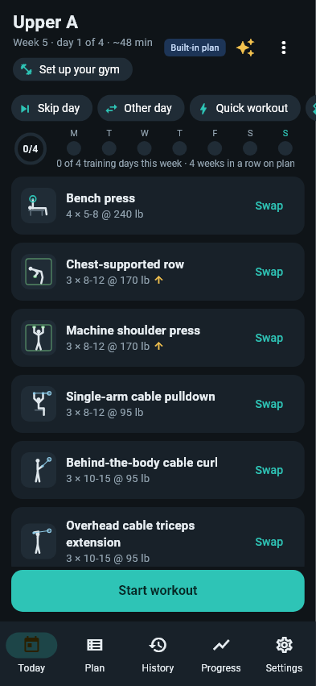 |  | 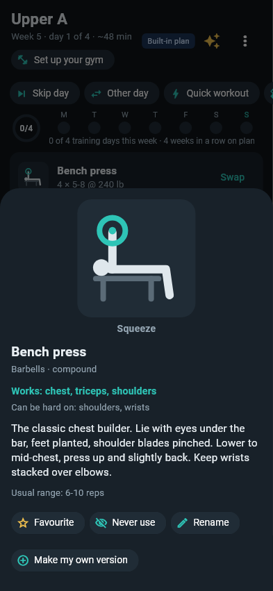 |  |
| **Today** | **During a workout** | **How to do it** | **Progress** |
| 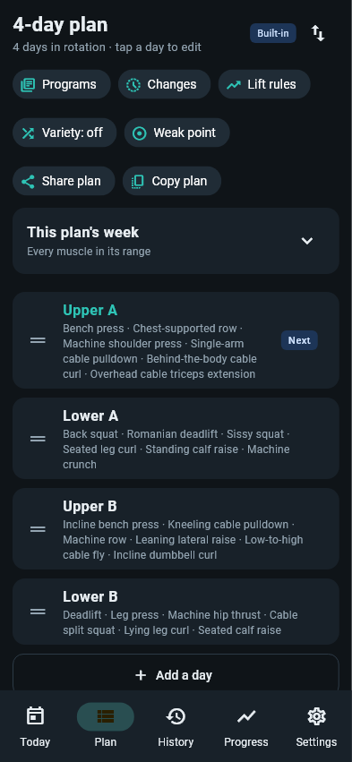 |  | 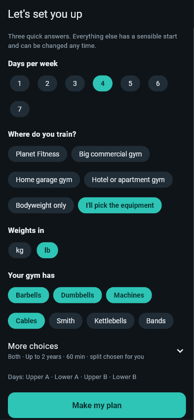 |  |
| **Your plan** | **296 exercises** | **Setup** | **Ask AI on your phone** |
| 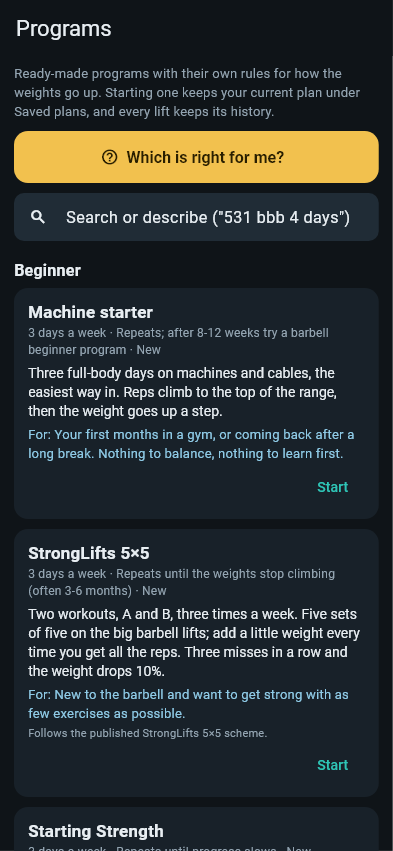 | 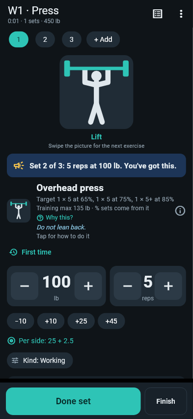 | 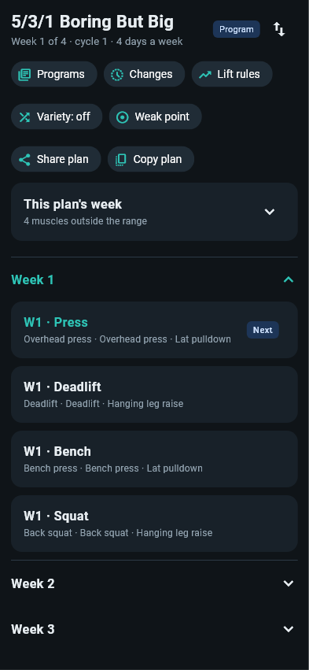 | 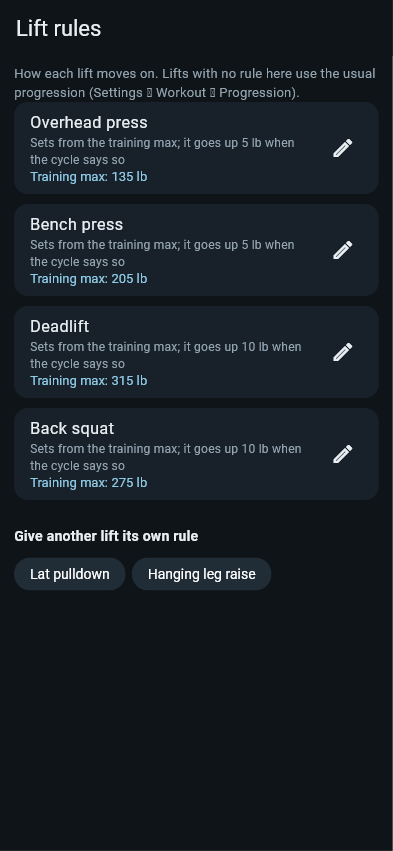 |
| **Programs** | **A program workout** | **Program weeks** | **Lift rules** |
| 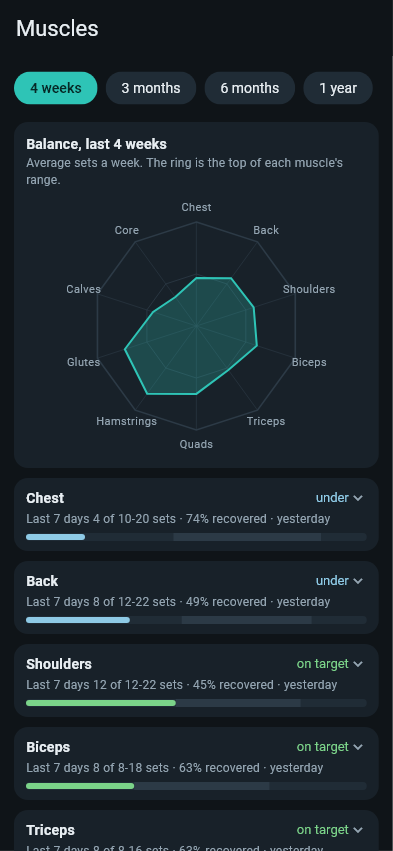 | 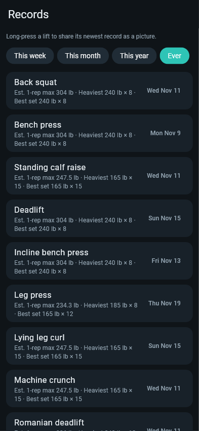 | 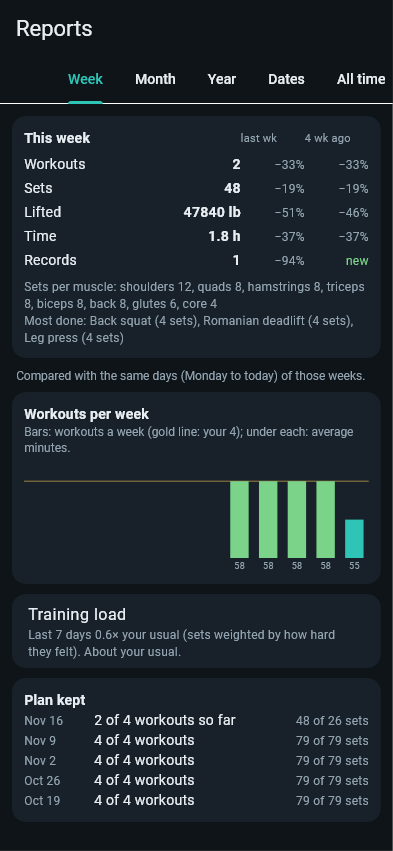 | 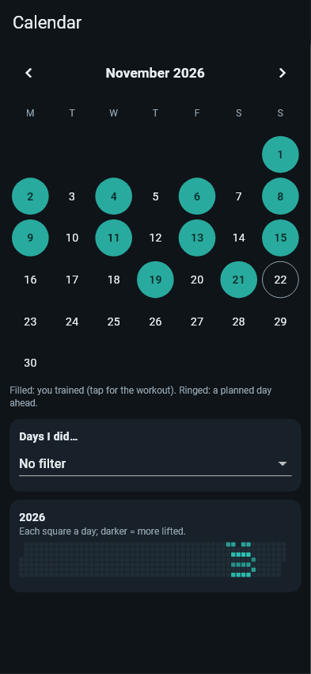 |
| **Muscles** | **Records** | **Reports** | **Calendar** |
| 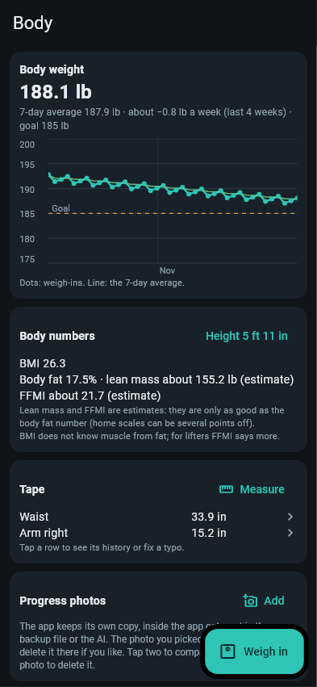 | 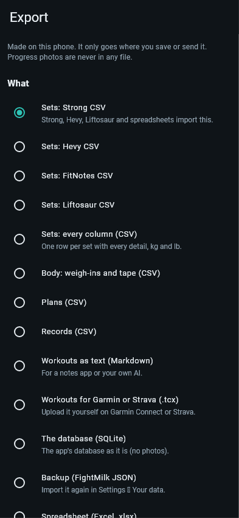 | | |
| **Body** | **Export** | | |

Rendered from the app's own screens with sample workouts (`app/test_screens/screenshots_test.dart`).

## Install

Download the APK from [Releases](https://github.com/Balderding/FightMilk/releases) (`-arm64` for almost every phone, `-universal` if unsure), open it and allow the install. Needs Android 7.0 or newer. After that the app can update itself: Settings → App updates. Every update is checked against the release's `SHA256SUMS.txt`, and Android only installs it over the old one if it is signed with the same key.

## Build it yourself

- Flutter (stable), Android SDK with NDK, JDK 17.
- `cd app && flutter test && flutter build apk --release`
- The on-phone AI engine is [llama.cpp](https://github.com/ggml-org/llama.cpp) release b12138, built from source by the app's CMake (`app/android/app/src/main/cpp`). Set `LLAMA_DIR` to a checkout of that release, or leave it unset and CMake fetches it.
- Exercise library, icons, animations and sounds are generated by the scripts in `tools/`.

## Licence

Privacy: see [PRIVACY.md](PRIVACY.md). Release APKs are signed with one key; its certificate's SHA-256 fingerprint is `f4f3906d08e2413d1c0175011d4ee29e7ebabce019df8a429eaa5f8e51c28989` (check it with AppVerifier or `apksigner verify --print-certs`).

Code: GPL-3.0 (see `LICENSE`). Exercise icons, explanations, animations and sounds: CC BY-SA 4.0 (see `LICENSE-ASSETS`). Made by balderding.

The AI models are not part of this repo. LFM models are made by Liquid AI under their own licence and are downloaded from Hugging Face by the app when you ask.
